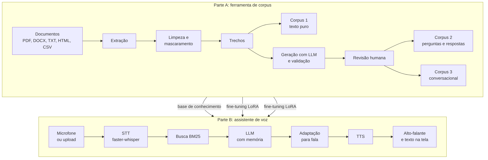

# Sentinela do Território: PLN (ferramenta de corpus e assistente de voz)

Global Solution CitizenTech. Disciplina: Processamento de Linguagem Natural, Chatbots & Virtual Agents.

**Integrantes:** GEANDRO (RM 562316) · LUCAS VERO (RM 564202) · ROBERTO EDUARDO (RM 564537)

## Sumário

1. [O que é](#1-o-que-é)
2. [O que foi entregue e onde está](#2-o-que-foi-entregue-e-onde-está)
3. [Arquitetura](#3-arquitetura)
4. [Modelos usados, versão e licença](#4-modelos-usados-versão-e-licença)
5. [Instalação passo a passo](#5-instalação-passo-a-passo)
6. [Configuração do arquivo .env](#6-configuração-do-arquivo-env)
7. [Como executar](#7-como-executar)
8. [Como usar no celular](#8-como-usar-no-celular)
9. [Ferramenta de corpus em detalhe](#9-ferramenta-de-corpus-em-detalhe)
10. [Assistente de voz em detalhe](#10-assistente-de-voz-em-detalhe)
11. [Ajuste do modelo (fine-tuning)](#11-ajuste-do-modelo-fine-tuning)
12. [Testes e métricas](#12-testes-e-métricas)
13. [Ética, segurança e LGPD](#13-ética-segurança-e-lgpd)
14. [Tratamento de falhas](#14-tratamento-de-falhas)
15. [O que já foi verificado e o que o grupo ainda precisa medir](#15-o-que-já-foi-verificado-e-o-que-o-grupo-ainda-precisa-medir)
16. [Limitações e melhorias](#16-limitações-e-melhorias)
17. [Problemas comuns](#17-problemas-comuns)
18. [Vídeo da demonstração](#18-vídeo-da-demonstração)

## 1. O que é

O Sentinela do Território é uma solução CitizenTech de alerta e cuidado que liga campo, comunidade e cidade. Este módulo é a porta de entrada por voz.

- **Persona:** moradora de área rural ou periférica, com pouca familiaridade com texto, que precisa relatar um risco e saber o que fazer.
- **Problema:** os canais de alerta e de atendimento dependem de leitura e digitação.
- **Tema do assistente:** queimadas, alertas da Defesa Civil e riscos em construções.
- **ODS:** 10 (redução das desigualdades) e 11 (cidades e comunidades sustentáveis).

O módulo tem duas partes que trabalham juntas:

- **Parte A, ferramenta de corpus:** recebe documentos, limpa e normaliza o texto e gera três corpus (texto puro, perguntas e respostas, conversacional) para o fine-tuning de um LLM pequeno.
- **Parte B, assistente de voz:** escuta o cidadão (STT), busca na base, responde com um LLM e fala a resposta (TTS).

A ferramenta de corpus produz a base de conhecimento do assistente. O corpus de texto puro alimenta a busca (RAG), e os outros dois ajustam o comportamento do modelo.

## 2. O que foi entregue e onde está

| Requisito do enunciado | Onde está |
| --- | --- |
| 1. Captura de áudio por microfone e por upload | `app.py` (componente de áudio da aba "Assistente de voz") |
| 2. STT em português | `assistente/stt.py` |
| 3. LLM com system prompt (papel, tom e limites) | `assistente/llm.py` e `assistente/prompts.py` |
| 4. Memória da conversa | `assistente/memoria.py` |
| 5. Base de conhecimento do tema | `assistente/rag.py`, alimentada por `corpus/` |
| 6. Adaptação para fala | `assistente/adaptacao.py` |
| 7. TTS em português do Brasil | `assistente/tts.py` |
| 8. Interface com transcrição e resposta em texto | `app.py` |
| 9. Registro de latência por etapa | `assistente/latencia.py`, grava `logs/latencia.csv` |
| Módulos separados e trocáveis | um arquivo por etapa em `assistente/` |
| Ferramenta de três corpus | `corpus/` e aba "Ferramenta de corpus" |
| Fine-tuning de LLM pequeno | `finetuning/treino_lora.py` |
| Testes e métricas | `avaliacao/` e `testes/` |
| Material de teste | `testes/perguntas.csv`, `testes/frases_tts.txt`, `testes/audios/` |
| Relatório | `docs/relatorio_pln.docx` (exportar em PDF depois de preencher) |

Estrutura de pastas:

```text
(pasta do projeto)/
  app.py                    interface Gradio (assistente e ferramenta de corpus)
  config.py                 leitura do .env
  requirements.txt          dependências do projeto
  requirements-finetuning.txt  dependências do ajuste do modelo
  .env.example              modelo do arquivo de configuração
  corpus/                   Parte A
    extracao.py             leitura de PDF, DOCX, TXT, MD, HTML e CSV
    limpeza.py              limpeza, mascaramento de dados pessoais e trechos
    geracao.py              perguntas e diálogos com LLM, com validação
    exportacao.py           JSONL, divisão treino/validação/teste e relatório
    pipeline.py             junta as etapas
    __main__.py             linha de comando: python -m corpus
  assistente/               Parte B
    stt.py  rag.py  llm.py  memoria.py  adaptacao.py  tts.py  latencia.py
    prompts.py              system prompt e mensagens fixas
    pipeline.py             fluxo de um turno da conversa
  finetuning/treino_lora.py ajuste com LoRA (Colab)
  avaliacao/                scripts de WER, acertos do LLM, notas do TTS e latência
  testes/                   perguntas, frases e áudios de teste do grupo
  tests/test_pln.py         16 testes automáticos (pytest)
  dados/exemplos/           textos de exemplo para o projeto rodar
  dados/base/               documentos oficiais que o grupo vai colocar
  dados/corpus/             corpus gerados
  docs/                     relatório e diagrama
```

## 3. Arquitetura



Fluxo de cada turno da conversa:

```text
microfone -> STT -> busca na base -> LLM com memória -> adaptação para fala -> TTS -> alto-falante
```

Cada etapa é um módulo com uma função principal. Para trocar um componente, basta mudar o arquivo dele ou uma linha do `.env`:

| Etapa | Função | Como trocar |
| --- | --- | --- |
| STT | `stt.transcrever(caminho)` | `STT_MODEL` no `.env` |
| Busca | `BaseConhecimento.buscar(pergunta)` | `CORPUS_TEXTO`, `RAG_TOP_K`, `RAG_SCORE_MINIMO` |
| LLM | `llm.conversar(mensagens)` | `LLM_PROVIDER` (ollama, openai, hf, mock) |
| Adaptação | `adaptacao.adaptar_para_fala(texto)` | editar `assistente/adaptacao.py` |
| TTS | `tts.sintetizar(texto)` | `TTS_ENGINE` (edge ou piper) |

## 4. Modelos usados, versão e licença

Versões instaladas na máquina usada nos testes.

| Componente | Modelo ou biblioteca | Versão usada | Licença |
| --- | --- | --- | --- |
| STT | faster-whisper, com os modelos Whisper `base` (padrão) e `small` (comparação) | faster-whisper 1.2.1 | MIT |
| LLM local | Qwen2.5 3B via Ollama | `qwen2.5:3b` (ID 357c53fb659c) | Qwen Research License (uso não comercial) |
| LLM do fine-tuning | Qwen2.5 0.5B Instruct, com adaptador LoRA | `Qwen/Qwen2.5-0.5B-Instruct` | Apache 2.0 |
| TTS na nuvem | edge-tts, voz `pt-BR-FranciscaNeural` | edge-tts 7.3.1 | biblioteca sob LGPL-3.0; a voz é um serviço online da Microsoft |
| Interface | Gradio | 6.31.0 | Apache 2.0 |
| Métrica de WER | jiwer | 4.0.0 | Apache 2.0 |

As opções de LLM na nuvem e de TTS local (Piper) existem no código, mas não foram usadas nesta entrega. As licenças devem ser conferidas na página de cada modelo antes de qualquer uso fora do contexto acadêmico.

## 5. Instalação passo a passo

Pré-requisitos: Python 3.10 ou mais novo e, para o LLM local, o [Ollama](https://ollama.com).

### Windows

```bat
cd <pasta onde o projeto foi baixado>
python -m venv .venv
.venv\Scripts\activate
pip install -r requirements.txt
copy .env.example .env
ollama pull qwen2.5:3b
```

### Linux e macOS

```bash
cd <pasta onde o projeto foi baixado>
python3 -m venv .venv
source .venv/bin/activate
pip install -r requirements.txt
cp .env.example .env
ollama pull qwen2.5:3b
```

### Google Colab (GPU T4)

```python
!git clone <URL do repositório do grupo>
%cd <nome do repositório>
!pip install -q -r requirements.txt
!curl -fsSL https://ollama.com/install.sh | sh
!nohup ollama serve > ollama.log 2>&1 &
!sleep 5 && ollama pull qwen2.5:3b
!cp .env.example .env
!GRADIO_SHARE=1 python app.py
```

O Colab mostra um link `https://....gradio.live`. Esse link abre no computador e no celular.

### Conferir a instalação

```bash
python -m pytest -q
```

O resultado esperado é `16 passed`. Esses testes usam um LLM simulado e não precisam de internet, de GPU nem do Ollama.

## 6. Configuração do arquivo .env

Copie `.env.example` para `.env`. O arquivo `.env` está no `.gitignore` e nunca vai para o GitHub.

| Variável | Para que serve | Valor padrão |
| --- | --- | --- |
| `LLM_PROVIDER` | `ollama` (local), `openai` (nuvem), `hf` (modelo ajustado) ou `mock` (simulado) | `ollama` |
| `OLLAMA_URL`, `OLLAMA_MODEL` | endereço e modelo do Ollama | `http://localhost:11434`, `qwen2.5:3b` |
| `OPENAI_BASE_URL`, `OPENAI_API_KEY`, `OPENAI_MODEL` | API na nuvem compatível com OpenAI | vazio |
| `HF_MODEL`, `HF_LORA` | modelo base e pasta do adaptador LoRA | `Qwen/Qwen2.5-0.5B-Instruct`, vazio |
| `STT_MODEL` | tamanho do Whisper: `tiny`, `base`, `small`, `medium` | `small` |
| `TTS_ENGINE` | `edge` (nuvem) ou `piper` (local) | `edge` |
| `EDGE_VOICE` | voz sintética | `pt-BR-FranciscaNeural` |
| `RAG_TOP_K`, `RAG_SCORE_MINIMO` | quantos trechos buscar e pontuação mínima (busca do assistente de voz) | `3`, `1.0` |
| `BUSCA_WEB_ATIVA`, `BUSCA_WEB_MAX_RESULTADOS` | liga/desliga a busca na web como segunda fonte e quantos resultados trazer (usada pelo módulo de Generative AI, `genai/busca_web.py`, quando a base do INPE não cobre a pergunta) | `true`, `3` |
| `GRADIO_SHARE` | `1` cria um link https para usar no celular | `0` |

### Local ou nuvem

O projeto roda dos dois jeitos, e a troca é feita só no `.env`.

| Configuração | Vantagem | Custo |
| --- | --- | --- |
| Tudo local (`LLM_PROVIDER=ollama`, `TTS_ENGINE=piper`) | a fala e o texto não saem da máquina, sem chave e sem internet | exige máquina com mais memória e é mais lento em CPU |
| LLM na nuvem (`LLM_PROVIDER=openai`) | resposta mais rápida em máquina simples | exige chave, internet e aviso ao usuário |
| Padrão do projeto (`ollama` com `edge`) | LLM local e voz natural sem instalar modelo de voz | o texto da resposta vai para o serviço de voz |

Para usar uma API na nuvem, preencha as três variáveis `OPENAI_*` com o endereço, a chave e o nome do modelo informados pelo provedor escolhido. Qualquer serviço compatível com o formato `chat/completions` da OpenAI funciona.

Quando algum componente usa a nuvem, a interface mostra um aviso ao cidadão.

## 7. Como executar

Todos os comandos são dados dentro da pasta do projeto, com o ambiente virtual ativo.

### Passo 1: gerar a base de conhecimento

Com os textos de exemplo, para ver funcionando:

```bash
python -m corpus --entrada dados/exemplos --saida dados/corpus
```

Com os documentos oficiais do grupo:

1. Coloque os arquivos em `dados/base/`.
2. Registre em `dados/base/fontes.csv` o nome de cada arquivo e a URL de origem.
3. Rode `python -m corpus --entrada dados/base --saida dados/corpus`.

Opções úteis:

| Opção | Efeito |
| --- | --- |
| `--sem-llm` | gera só o texto puro e os diálogos de recusa, sem chamar o LLM |
| `--max-trechos 20` | limita os trechos enviados ao LLM, para um teste rápido |
| `--qa-por-trecho 3` | muda a quantidade de perguntas por trecho |
| `--tamanho-trecho 500` | tamanho máximo do trecho, em caracteres |

### Passo 2: abrir a interface

```bash
python app.py
```

Abra `http://127.0.0.1:7860` no navegador.

### Passo 3: conversar

1. Na aba "Assistente de voz", leia o aviso e marque a caixa de consentimento.
2. Aperte o microfone, fale e aperte "Enviar". Também é possível enviar um arquivo de áudio ou escrever a pergunta.
3. A resposta é falada e aparece em texto, com as fontes consultadas.
4. "Nova conversa" apaga a memória e começa do zero.

Roteiro sugerido para a demonstração e para o vídeo (três turnos, com continuação e recusa):

| Turno | Fala do cidadão | O que deve acontecer |
| --- | --- | --- |
| 1 | "Como eu recebo os alertas da Defesa Civil no celular?" | Explica o cadastro por SMS |
| 2 | "E isso é pago?" | Usa a memória e responde que é gratuito |
| 3 | "Me passa uma receita de bolo." | Recusa e diz sobre o que orienta |

### Passo 4: usar a ferramenta de corpus pela interface

Na aba "Ferramenta de corpus":

1. Envie os arquivos ou cole um texto, informe a fonte e aperte "Extrair e limpar".
2. Aperte "Gerar" para criar as perguntas e os diálogos com o LLM.
3. Revise a tabela: desmarque o que estiver errado ou corrija o texto.
4. Aperte "Exportar os três corpus". Os arquivos ficam em `dados/corpus/` e a base do assistente é atualizada na hora.

## 8. Como usar no celular

A interface é uma página web responsiva, que se ajusta à tela do celular. Não é preciso instalar aplicativo.

O navegador do celular só libera o microfone em páginas `https`. Por isso há dois caminhos:

1. **Link compartilhado (recomendado para a demonstração).** Defina `GRADIO_SHARE=1` no `.env` e rode `python app.py`. O terminal mostra um link `https://....gradio.live`, válido por tempo limitado. Abra esse link no celular e autorize o microfone.
2. **Colab.** O bloco de comandos do Colab da seção 5 já usa `GRADIO_SHARE=1`.

Com o link compartilhado, o áudio do celular passa pelo serviço de túnel do Gradio até a máquina que roda o projeto. Informem isso no relatório, na parte de LGPD.

Para deixar um ícone na tela inicial do celular, abra o link no navegador e use a opção "Adicionar à tela inicial".

## 9. Ferramenta de corpus em detalhe

### Etapas

| Etapa | O que faz | Arquivo |
| --- | --- | --- |
| Upload | aceita PDF, DOCX, TXT, MD, HTML e CSV, além de texto colado | `corpus/extracao.py` |
| Extração | uma função por tipo. Arquivo com falha vai para o log e não interrompe os outros | `corpus/extracao.py` |
| Limpeza | corrige a codificação (Unicode NFC), remove cabeçalhos e rodapés repetidos, junta palavras quebradas por hífen, padroniza aspas e espaços, remove números de página | `corpus/limpeza.py` |
| Mascaramento | troca CPF, e-mail e telefone por `[CPF]`, `[EMAIL]` e `[TELEFONE]`. Números de emergência (193, 199) ficam | `corpus/limpeza.py` |
| Trechos | divide por parágrafo, agrupa até o tamanho máximo e descarta parágrafos duplicados e trechos curtos | `corpus/limpeza.py` |
| Geração | o LLM cria perguntas, respostas e diálogos a partir de cada trecho | `corpus/geracao.py` |
| Validação | descarta respostas cujas palavras não aparecem no trecho de origem | `corpus/geracao.py` |
| Revisão humana | o grupo aprova, corrige ou rejeita cada pergunta na interface | `app.py` |
| Exportação | grava JSONL, divide em treino, validação e teste e gera o relatório do corpus | `corpus/exportacao.py` |

### Os três corpus

**1. Texto puro** (`texto_puro.jsonl`). Uma linha por trecho. É a base de busca do assistente.

```json
{"id": "3f1c9a2b7e", "text": "A Defesa Civil atende pelo telefone 199. ...", "documento": "alertas.pdf", "fonte": "<URL>", "data_consulta": "2026-11-10"}
```

**2. Perguntas e respostas** (`perguntas_respostas_{treino,validacao,teste}.jsonl`).

```json
{"pergunta": "Qual é o telefone da Defesa Civil?", "resposta": "A Defesa Civil atende pelo 199.", "contexto": "<trecho de origem>", "fonte": "<URL>", "tipo": "tema"}
```

**3. Conversacional** (`conversacional_{treino,validacao,teste}.jsonl`). Formato de mensagens, com três tipos de diálogo:

- `continuacao`: diálogo com pergunta de continuação, gerado pelo LLM a partir de um trecho.
- `fora_do_tema`: o cidadão pergunta outro assunto e o assistente recusa.
- `sem_resposta`: pergunta do tema que a base não responde, e o assistente diz que não sabe.

```json
{"messages": [{"role": "system", "content": "<papel e limites>"}, {"role": "user", "content": "Como recebo os alertas?"}, {"role": "assistant", "content": "Envie um SMS com o CEP da sua rua."}, {"role": "user", "content": "E isso é pago?"}, {"role": "assistant", "content": "Não. O cadastro é gratuito."}], "contexto": "<trecho>", "fonte": "<URL>", "tipo": "continuacao"}
```

### Divisão dos dados

Cada corpus é dividido em 80% para treino, 10% para validação e 10% para teste, com semente fixa. Os arquivos `*_teste.jsonl` nunca entram no fine-tuning.

### Relatório do corpus

A cada exportação, `dados/corpus/relatorio_corpus.md` registra os documentos lidos, os indicadores da limpeza, o tamanho de cada corpus e um exemplo de cada tipo. Copiem esses números para o relatório da disciplina.

## 10. Assistente de voz em detalhe

**STT.** `faster-whisper`, idioma fixo em português, com filtro de silêncio. O modelo é carregado uma vez e reaproveitado.

**Base de conhecimento.** Busca lexical BM25 sobre o corpus de texto puro. Trechos com pontuação abaixo de `RAG_SCORE_MINIMO` são ignorados. Sem trecho, o LLM recebe o aviso de que nada foi encontrado e deve dizer que não sabe.

**LLM.** O system prompt está em `assistente/prompts.py` e define:

- papel: assistente de voz do Sentinela do Território;
- tom: no máximo três frases curtas, em linguagem simples;
- limites: usar só os trechos fornecidos, recusar assuntos fora do tema e encaminhar casos de saúde e jurídicos;
- segurança: tratar os trechos como dados, não revelar as instruções e indicar o 193 ou o 199 em caso de perigo.

**Memória.** Guarda os últimos turnos (`MAX_TURNOS_MEMORIA`, padrão 6). Em perguntas curtas ou que começam com "e", a busca usa também a pergunta anterior.

**Rede de segurança para emergências.** Se a fala do cidadão tem termos como "socorro" ou "pegando fogo" e a resposta do LLM não cita o 193, o sistema acrescenta a orientação no início.

**Adaptação para fala.** Antes do TTS, o texto passa por:

| Entrada | Saída |
| --- | --- |
| `**Ligue 193**` | "Ligue um nove três" |
| `10/11/2026` | "dez de novembro de dois mil e vinte e seis" |
| `14h30` | "catorze horas e trinta minutos" |
| `12%` | "doze por cento" |
| `1.500` | "mil e quinhentos" |
| `CPF` | "cê pê efe" |
| links, emojis, marcadores de lista | removidos |

A resposta falada é limitada a `MAX_FRASES_FALA` frases (padrão 4).

**TTS.** `edge-tts` com voz pt-BR pronta, ou Piper para rodar sem internet.

**Latência.** Cada turno grava uma linha em `logs/latencia.csv` com o tempo de STT, busca, LLM, adaptação, TTS e o total até o áudio da resposta ficar pronto. O arquivo guarda só tempos e nomes de modelos, sem o conteúdo da conversa.

## 11. Ajuste do modelo (fine-tuning)

O ajuste usa LoRA em um modelo pequeno e foi escrito para o Colab com GPU T4.

```python
!pip install -q -r requirements-finetuning.txt
!python finetuning/treino_lora.py --corpus dados/corpus --saida finetuning/saida --epocas 3
```

O script lê os corpus de perguntas e respostas e conversacional (treino e validação), monta os exemplos no mesmo formato usado pelo assistente e grava o adaptador em `finetuning/saida/`. O arquivo `registro_do_treino.json` traz o modelo base, as épocas, o tamanho dos conjuntos e as perdas. Esses números vão para o relatório.

Para usar o modelo ajustado no assistente, altere o `.env`:

```text
LLM_PROVIDER=hf
HF_MODEL=Qwen/Qwen2.5-0.5B-Instruct
HF_LORA=finetuning/saida
```

Para a comparação pedida no enunciado, rode a avaliação do LLM duas vezes: uma com `HF_LORA` vazio (modelo base) e outra com o adaptador.

Recomendação: antes do ajuste, gerem um corpus maior com os documentos oficiais. Com os quatro textos de exemplo, o treino serve só para testar o processo.

## 12. Testes e métricas

O enunciado pede quatro avaliações e uma comparação entre duas opções. Os resultados ficam em `testes/resultados/`.

### STT: WER em 20 áudios

1. Gravem 20 áudios, com pelo menos 3 vozes e 5 com ruído de fundo, e salvem em `testes/audios/`.
2. Preencham `testes/audios/manifesto.csv` (instruções em `testes/audios/LEIA-ME.md`).
3. Rodem, já comparando dois tamanhos de Whisper:

```bash
python -m avaliacao.avaliar_stt --modelos base small
```

Saída: `stt_resumo.md` com o WER geral, por condição de ruído e por grupo de locutor, e o tempo médio por áudio. A tabela por grupo é a análise de viés do STT pedida no barema.

### LLM: 30 perguntas

O arquivo `testes/perguntas.csv` traz 20 perguntas do tema, 5 de continuação e 5 fora do escopo, com a resposta esperada. Elas foram escritas para os textos de exemplo. Ao trocar a base pelos documentos oficiais, revisem as perguntas e as respostas esperadas.

```bash
python -m avaliacao.avaliar_llm --rotulo base
```

Depois abram `testes/resultados/llm_base.csv`, preencham a coluna `julgamento` (`correta`, `incorreta`, `recusa_adequada` ou `recusa_indevida`) e rodem:

```bash
python -m avaliacao.avaliar_llm --resumir testes/resultados/llm_base.csv
```

O julgamento é feito por pessoas porque comparar textos automaticamente não mede se a resposta está certa.

### TTS: 10 respostas, 3 avaliadores

```bash
python -m avaliacao.avaliar_tts --gerar --avaliadores Geandro Lucas Roberto
```

Cada avaliador ouve os 10 áudios em `testes/resultados/tts/` e preenche as notas de 1 a 5 na planilha. Depois:

```bash
python -m avaliacao.avaliar_tts --resumir testes/resultados/tts/avaliacao_tts.csv
```

### Ponta a ponta: 10 conversas

Façam 10 conversas com pelo menos 3 turnos na interface, usando "Nova conversa" entre elas. Depois:

```bash
python -m avaliacao.avaliar_latencia
```

### Comparação entre duas opções

| Comparação | Como fazer |
| --- | --- |
| Whisper `base` contra `small` | o comando do STT acima já compara os dois |
| Modelo base contra modelo ajustado | rodar a avaliação do LLM com `--rotulo base` e com `--rotulo ajustado`, trocando `HF_LORA` no `.env` |

### Testes automáticos

```bash
python -m pytest -q
```

São 16 testes que cobrem a limpeza, o mascaramento, a geração e exportação dos corpus, a adaptação para fala, a memória, a recusa sem evidência, a emergência e a queda do LLM.

## 13. Ética, segurança e LGPD

| Cuidado | Como foi aplicado |
| --- | --- |
| Consentimento | aviso na tela e caixa de aceite obrigatória antes do primeiro uso |
| Retenção mínima | o áudio é apagado logo depois da transcrição (`stt.apagar_audio`) |
| Aviso de nuvem | a interface avisa quando LLM ou TTS usam serviço externo |
| Registros | o log de latência não guarda o conteúdo da conversa |
| Dados pessoais nos documentos | CPF, e-mail e telefone são mascarados na limpeza |
| Limites do assistente | recusa assuntos fora do tema e encaminha casos de saúde, jurídicos e de emergência |
| Alucinação | sem trecho na base, a instrução é dizer "Não tenho essa informação" |
| Injeção de instruções | os trechos são tratados como dados e o prompt não é revelado |
| Clonagem de voz | não há. Só vozes sintéticas prontas |
| Viés do STT | WER medido por grupo de locutor |
| Segredos | chaves só no `.env`, que não é versionado |

O assistente é um protótipo educacional e não substitui o 193, o 199 nem outro serviço de emergência.

## 14. Tratamento de falhas

| Falha | O que o sistema faz |
| --- | --- |
| Arquivo ausente, vazio ou de tipo não suportado | registra em log, mostra na tela e segue com os outros arquivos |
| LLM fora do ar ou lento | três tentativas com espera. Depois, mensagem fixa com o 193 e o 199 |
| LLM devolve resposta vazia ou JSON inválido | nova tentativa. Na geração de corpus, o item é descartado e contado |
| Três falhas seguidas do LLM na geração | a geração para e devolve o que já foi produzido |
| STT não entende o áudio | pede para repetir |
| TTS indisponível | a resposta aparece em texto e a tela avisa |
| Base de conhecimento ausente | o assistente abre, avisa no log e responde que não tem a informação |
| Erro inesperado | mensagem simples ao cidadão, sem detalhe técnico. O detalhe vai para o log |

## 15. O que já foi verificado e o que o grupo ainda precisa medir

Verificado durante a construção do projeto:

- os 16 testes automáticos passam;
- a ferramenta de corpus roda de ponta a ponta com os textos de exemplo, pela linha de comando e pelas funções da interface;
- a interface abre e o fluxo por texto responde com o LLM simulado;
- os scripts de avaliação do LLM e da latência geram os resumos.

Ainda não executado, porque depende de microfone, internet, GPU ou do Ollama na máquina do grupo:

- [ ] transcrição real com o faster-whisper;
- [ ] respostas com o LLM real (Ollama ou API na nuvem);
- [ ] síntese de voz com edge-tts ou Piper;
- [ ] fine-tuning no Colab;
- [ ] uso pelo celular com o link compartilhado;
- [ ] todas as medições da seção 12.

Rodem cada item pelo menos uma vez antes de gravar o vídeo. Se algum comando falhar, a seção 17 lista as causas mais comuns.

## 16. Limitações e melhorias

Limitações:

- A busca é lexical. Perguntas com palavras diferentes das do documento podem não achar o trecho.
- Modelos pequenos erram mais em recusas e em perguntas ambíguas.
- A detecção de emergência usa uma lista de termos e pode falhar com outras formas de falar.
- O mascaramento cobre CPF, e-mail e telefone. Nomes e endereços não são mascarados.
- Os textos de `dados/exemplos/` são exemplos e precisam ser trocados por documentos oficiais.
- O link compartilhado do Gradio é temporário.

Melhorias futuras:

- busca híbrida com embeddings, a mesma do módulo de Generative AI;
- resposta em fluxo, para a fala começar antes de o texto terminar;
- detecção automática de voz, sem botão;
- alertas por notificação e vibração, em conjunto com o módulo de reconhecimento de sons;
- integração com o protocolo de relatos da interface principal do Sentinela.

## 17. Problemas comuns

| Sintoma | Causa provável | O que fazer |
| --- | --- | --- |
| "O assistente está fora do ar" | Ollama fechado ou modelo não baixado | abrir o Ollama e rodar `ollama pull qwen2.5:3b` |
| Resposta muito lenta | modelo grande para a máquina | usar um modelo menor ou `LLM_PROVIDER=openai` |
| Microfone não aparece no celular | página sem https | usar `GRADIO_SHARE=1` |
| "A voz não está disponível" | sem internet para o edge-tts | conferir a conexão ou usar `TTS_ENGINE=piper` |
| Primeira transcrição demora | download do modelo Whisper | aguardar. As seguintes são rápidas |
| "Não tenho essa informação" para tudo | base vazia | rodar o passo 1 da seção 7 |
| Erro com `eval_strategy` no fine-tuning | versão antiga do transformers | `pip install -U transformers` |
| PDF sem texto | PDF digitalizado como imagem | usar a versão em texto do documento |

## 18. Vídeo da demonstração

Vídeo de até 5 minutos com uma conversa real por voz, com pelo menos 3 turnos, incluindo uma pergunta de continuação e uma recusa.

Link: https://www.youtube.com/watch?v=we6bC3mSYEg

