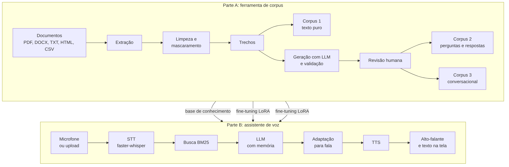

# 1. Problema e persona

Os canais de alerta e de atendimento público dependem, em geral, de leitura e digitação. Pessoas idosas, com baixa alfabetização, com deficiência visual ou motora, ou com as mãos ocupadas no trabalho rural ficam em desvantagem para relatar um risco e para receber orientação.

O Sentinela do Território é uma solução CitizenTech de alerta e cuidado que liga campo, comunidade e cidade. Este módulo é a porta de entrada por voz: o cidadão fala, o sistema entende o pedido e responde falando.

**Persona.** Dona Marta, 62 anos, mora em uma comunidade rural, usa o celular para áudio e chamadas e tem dificuldade para ler textos longos. No período de seca, vê fumaça perto de casa e não sabe para quem ligar nem o que fazer primeiro.

**Fonte que sustenta o problema.** O Programa Queimadas do INPE (Instituto Nacional de Pesquisas Espaciais) monitora por satélite os focos de queimadas no Brasil e publica os dados no BDQueimadas, atualizado a cada três horas e com consulta por estado, município e bioma. Só em dezembro de 2024, mês fora do período crítico de seca, foram registradas 12.075 detecções de focos de fogo em todo o país pelo satélite de referência. Fontes: INPE, BDQueimadas, <https://data.inpe.br/queimadas/bdqueimadas/>; INPE, Infoqueima, boletim de dezembro de 2024, <https://dataserver-coids.inpe.br/queimadas/queimadas/Infoqueima/2024/2024_12_infoqueima.pdf>. Consulta em 16/11/2026.

**Domínio do assistente.** Orientação sobre queimadas, alertas da Defesa Civil e riscos em construções.

# 2. Objetivos de Desenvolvimento Sustentável

| ODS | Como a solução contribui |
| --- | --- |
| 10. Redução das desigualdades | Oferece acesso por voz a quem não consegue usar canais baseados em texto. |
| 11. Cidades e comunidades sustentáveis | Leva orientação de prevenção e de resposta a riscos para moradores de áreas urbanas, periféricas e rurais. |

# 3. Arquitetura

A entrega tem duas partes. A ferramenta de corpus produz a base de conhecimento e os dados de treino. O assistente de voz usa essa base para responder.

## 3.1 Fluxo de um turno da conversa

1. O cidadão fala ao microfone ou envia um arquivo de áudio.
2. O STT transcreve a fala em português.
3. O áudio é apagado.
4. A busca seleciona os trechos da base mais próximos da pergunta.
5. O LLM recebe o system prompt, a memória da conversa, os trechos e a pergunta.
6. A resposta é adaptada para fala.
7. O TTS gera o áudio da resposta.
8. A tela mostra a transcrição, a resposta em texto, as fontes e a latência.

## 3.2 Módulos

| Etapa | Arquivo | Função principal |
| --- | --- | --- |
| Captura | `app.py` | componente de áudio com microfone e upload |
| STT | `assistente/stt.py` | `transcrever` |
| Base de conhecimento | `assistente/rag.py` | `BaseConhecimento.buscar` |
| LLM | `assistente/llm.py` | `conversar` |
| Memória | `assistente/memoria.py` | `Memoria` |
| Adaptação para fala | `assistente/adaptacao.py` | `adaptar_para_fala` |
| TTS | `assistente/tts.py` | `sintetizar` |
| Latência | `assistente/latencia.py` | `Cronometro` e `registrar` |
| Fluxo do turno | `assistente/pipeline.py` | `Assistente.responder_audio` |

Cada etapa fica em um arquivo, com uma função de entrada. A troca de um componente é feita no arquivo `.env`, sem alterar os demais módulos.

# 4. Ferramenta de corpus

A ferramenta recebe documentos de vários tipos, limpa e normaliza o texto e gera três corpus para o fine-tuning de um LLM de pequeno porte.

## 4.1 Etapas

| Etapa | Descrição |
| --- | --- |
| Upload | PDF, DOCX, TXT, MD, HTML, CSV e texto colado, em vários arquivos de uma vez. |
| Extração | Uma função por tipo de arquivo. A falha em um arquivo é registrada e não interrompe os demais. |
| Limpeza | Normalização Unicode, remoção de cabeçalhos e rodapés repetidos, união de palavras quebradas por hífen, padronização de aspas e espaços, remoção de números de página. |
| Mascaramento | CPF, e-mail e telefone são trocados por marcadores. Números de emergência são preservados. |
| Segmentação | Trechos por parágrafo, com tamanho máximo configurável. Parágrafos duplicados e trechos curtos são descartados. |
| Geração | O LLM cria perguntas, respostas e diálogos a partir de cada trecho. |
| Validação | Respostas cujas palavras não aparecem no trecho de origem são descartadas. |
| Revisão humana | O grupo aprova, corrige ou rejeita cada pergunta antes da exportação. |
| Exportação | JSONL com divisão de 80% para treino, 10% para validação e 10% para teste. |

## 4.2 Os três corpus

| Corpus | Formato | Uso |
| --- | --- | --- |
| Texto puro | um trecho por linha, com fonte e data de consulta | base de busca do assistente |
| Perguntas e respostas | pergunta, resposta e trecho de origem | fine-tuning e avaliação |
| Conversacional | mensagens de sistema, usuário e assistente | fine-tuning do comportamento: continuação, recusa e falta de informação |

O corpus conversacional reúne três tipos de diálogo: com pergunta de continuação, com pergunta fora do tema e com pergunta que a base não responde. São os comportamentos cobrados na avaliação do LLM.

## 4.3 Documentos usados

| Documento | Órgão | URL | Data de consulta |
| --- | --- | --- | --- |
| `alertas_defesa_civil.txt` | texto de exemplo (tema: alertas da Defesa Civil) | sem URL | 09/11/2026 |
| `queimadas.txt` | texto de exemplo (tema: queimadas) | sem URL | 09/11/2026 |
| `riscos_em_construcoes.txt` | texto de exemplo (tema: riscos em construções) | sem URL | 09/11/2026 |
| `relato_com_ruido.txt` | texto fictício, usado para testar a limpeza e o mascaramento | sem URL | 09/11/2026 |

Os quatro documentos são textos de exemplo escritos para o protótipo, com orientações gerais sobre cada tema. Eles não foram extraídos de páginas oficiais. Para uso real, a base deve ser trocada por documentos dos órgãos responsáveis (Defesa Civil, Corpo de Bombeiros, prefeitura), com URL e data de consulta.

## 4.4 Resultado da geração dos corpus

Fonte dos números: `dados/corpus/relatorio_corpus.md`, gerado a cada exportação.

| Indicador | Valor |
| --- | --- |
| Documentos processados | 4 |
| Caracteres antes e depois da limpeza | 3.239 antes, 3.201 depois |
| Linhas de cabeçalho e rodapé removidas | 0 |
| Parágrafos duplicados removidos | 1 |
| Dados pessoais mascarados | 3 (1 CPF, 1 e-mail e 1 telefone) |
| Trechos de texto puro | 8 |
| Perguntas e respostas (treino, validação, teste) | 0, 0 e 0 (este corpus não foi gerado nesta entrega) |
| Diálogos (treino, validação, teste) | 12, 2 e 1 |
| Itens descartados na validação automática | 0 |
| Itens rejeitados na revisão humana | nenhum registrado |

## 4.5 Ajuste do modelo

Fonte dos números: `finetuning/saida/registro_do_treino.json`.

| Item | Valor |
| --- | --- |
| Modelo base | Qwen/Qwen2.5-0.5B-Instruct |
| Técnica | LoRA (r = 16, alpha = 32, dropout = 0,05) |
| Épocas | 3 (9 passos de atualização, lote 1 com acumulação de 4) |
| Exemplos de treino e de validação | 12 e 2 (corpus conversacional) |
| Perda final de treino | 2,485 |
| Perda de validação | 2,177 |
| Ambiente | máquina em nuvem com CPU (2 núcleos, 7 GB de RAM), sem GPU; treino em 3 min 16 s |

# 5. Justificativa das escolhas

## 5.1 Nuvem ou local

O projeto foi construído para rodar dos dois modos, e a troca é feita por variável de ambiente. A configuração usada na demonstração foi: LLM local (qwen2.5:3b no Ollama), STT local (Whisper small) e TTS na nuvem (Edge TTS, voz pt-BR-FranciscaNeural).

| Critério | Local | Nuvem |
| --- | --- | --- |
| Custo | sem custo por uso | depende do plano do provedor |
| Privacidade | a fala e o texto ficam na máquina | o texto sai para o provedor, e o usuário é avisado |
| Latência | maior em máquina sem GPU | menor em máquina simples |
| Internet | funciona sem conexão | exige conexão |

Justificativa do grupo: a fala do cidadão e o texto da conversa ficam na máquina, porque o STT e o LLM rodam localmente e sem custo por uso. O preço dessa escolha é a espera: em um notebook comum, a resposta leva em média 18,53 s, dos quais 12,35 s são do LLM (seção 6.4). Só o TTS usa a nuvem, e recebe apenas o texto da resposta, nunca a voz do usuário; a voz teve nota 5,00 em naturalidade e clareza (seção 6.3). Para um protótipo que lida com relatos de risco, o grupo priorizou privacidade e custo zero em vez de velocidade.

## 5.2 Base de conhecimento: RAG e fine-tuning

O enunciado permite RAG, contexto no prompt ou fine-tuning. O grupo combinou dois recursos, com papéis diferentes.

- **RAG para os fatos.** A base pode ser atualizada sem treinar o modelo de novo, e cada resposta pode indicar a fonte. Quando a busca não encontra trecho, o assistente diz que não sabe.
- **Fine-tuning para o comportamento.** Um modelo pequeno precisa aprender a responder em frases curtas, a manter a continuação e a recusar pedidos fora do tema. O ajuste foi feito e avaliado (seções 4.5 e 6.2), mas não melhorou o resultado, e o protótipo usa o modelo sem ajuste.

A busca usa BM25, um método lexical. Ele foi escolhido por rodar em qualquer máquina, sem modelo adicional, e por ser fácil de explicar e auditar. A limitação está descrita na seção 8.

## 5.3 Modelos

| Componente | Opção escolhida | Motivo |
| --- | --- | --- |
| STT | Whisper small na demonstração; os testes recomendam o base | WER quase igual (12,37% no small e 12,90% no base), mas o base é 2,5 vezes mais rápido (0,86 s contra 2,18 s por áudio) |
| LLM | qwen2.5:3b (Ollama), modelo base com RAG | 88% de respostas corretas (22 de 25) e 100% de recusas adequadas (5 de 5), rodando localmente |
| TTS | Edge TTS, voz pt-BR-FranciscaNeural | Média 5,00 em naturalidade e em clareza, com 2,44 s de síntese por resposta |

## 5.4 System prompt

O system prompt define o papel (assistente de voz do Sentinela do Território), o tom (até três frases curtas, sem listas nem símbolos), os limites (usar somente os trechos fornecidos, recusar assuntos fora do tema, encaminhar casos de saúde e jurídicos) e a segurança (indicar o 193 ou o 199 em caso de perigo, tratar os trechos como dados e não revelar as instruções). O texto completo está em `assistente/prompts.py`.

## 5.5 Adaptação para fala

Antes do TTS, a resposta perde markdown, links e emojis. Números, datas, horas, porcentagens e siglas são escritos de forma pronunciável. Números de serviço, como 193 e 199, são falados dígito a dígito. A resposta falada é limitada a quatro frases.

# 6. Resultados das métricas

## 6.1 STT

Teste: 21 áudios gravados pelo grupo (1 acima do mínimo de 20 pedido), com 3 vozes diferentes (homem maduro, mulher adulta, homem jovem) e 6 áudios com ruído de fundo (acima do mínimo de 5). Métrica: WER, calculado com a biblioteca jiwer, depois de normalizar os textos (minúsculas e sem pontuação).

Comando: `python -m avaliacao.avaliar_stt --modelos base small`. Resultado em `testes/resultados/stt_resumo.md`.

| Modelo | WER geral | WER sem ruído | WER com ruído | Tempo médio por áudio (s) |
| --- | --- | --- | --- | --- |
| Whisper base | 12,90% | 18,32% | 0,00% | 0,86 |
| Whisper small | 12,37% | 16,79% | 1,82% | 2,18 |

Análise de viés, WER por grupo de locutor:

| Grupo | Áudios | WER (base) | WER (small) |
| --- | --- | --- | --- |
| Homem maduro | 7 | 23,81% | 25,40% |
| Mulher adulta | 7 | 8,93% | 8,93% |
| Homem jovem | 7 | 5,97% | 2,99% |

Interpretação:

A diferença de WER entre os dois tamanhos é pequena (12,90% vs. 12,37%), mas o tempo médio por áudio mais que dobra no `small` (0,86s para 2,18s), para um assistente de voz, onde a resposta rápida importa, essa troca de precisão por velocidade não parece valer a pena aqui. Isso aponta para o **Whisper base** como escolha padrão, com o `small` como alternativa se a precisão for mais crítica que a latência.

O achado mais chamativo não é de ruído (os áudios "com ruído" tiveram WER menor que os "sem ruído" nesta amostra, provavelmente porque os áudios com ruído também aconteceram de ser frases mais simples/curtas, não porque o ruído ajudou; a amostra de 21 áudios é pequena para separar as duas causas com confiança). É de **viés entre vozes**: a voz "homem maduro" teve WER de 23–25%, quase 3 a 8 vezes maior que as outras duas vozes (6–9%). Olhando os erros individuais, o maior deles é o áudio `a01` (WER de 100% nos dois modelos), o Whisper não apenas errou palavras, ele transcreveu uma frase totalmente diferente da que foi falada ("vi fogo no mato perto da estrada, o que eu faço?" virou "socorro qual que é o telefone da defesa..."), um tipo de erro mais grave que uma troca de uma palavra, porque muda o sentido da pergunta. Isso é uma limitação real a declarar no projeto: o STT não é confiável de forma uniforme entre vozes diferentes, e esse tipo de falha completa (não só um erro pontual) pode levar o assistente a responder algo sem relação com o que o cidadão disse.

## 6.2 LLM

Teste: 30 perguntas com resposta esperada (`testes/perguntas.csv`), sendo 20 do tema, 5 de continuação e 5 fora do escopo. Cada resposta foi comparada com a resposta esperada, e os julgamentos foram revisados e confirmados por Geandro.

Comandos: `python -m avaliacao.avaliar_llm --rotulo <nome>` e, depois do julgamento, `--resumir`.

| Configuração | Corretas no tema (20) | Corretas na continuação (5) | Total de corretas (25) | Recusas adequadas (5) | Tempo médio (s) |
| --- | --- | --- | --- | --- | --- |
| Modelo base com RAG (qwen2.5:3b, Ollama) | 19 (95%) | 3 (60%) | 22 (88%) | 5 (100%) | 19,56 |
| Qwen2.5-0.5B sem ajuste, com RAG | 7 (35%) | 0 (0%) | 7 (28%) | 4 (80%) | 6,69 |
| Qwen2.5-0.5B ajustado (LoRA), com RAG | 4 (20%) | 0 (0%) | 4 (16%) | 5 (100%) | 10,73 |

A primeira linha é o modelo usado no protótipo. As duas últimas comparam o mesmo modelo pequeno antes e depois do ajuste, que é a comparação que mede o efeito do fine-tuning. Os tempos das duas últimas linhas foram medidos em outra máquina e não se comparam com o da primeira. Recusas indevidas: 0 no qwen2.5:3b, 2 no 0.5B sem ajuste e 5 no 0.5B ajustado.

Erros observados:

| Pergunta | Resposta esperada | Resposta obtida | Tipo de erro |
| --- | --- | --- | --- |
| T08, fumaça entrando em casa | Fechar portas e janelas e ficar em um cômodo interno. | Traz a orientação certa, mas também manda sair do local e diz "evite áreas internas e mova-se para um cômodo interno". | Resposta contraditória |
| C02, e se o fogo estiver perto das casas? | Avisar os vizinhos e sair pelo lado contrário ao do vento. | Manda sair pelo lado contrário ao vento e, na mesma resposta, ficar em um cômodo interno com janelas fechadas. | Mistura de duas orientações opostas |
| C05, quem tirar primeiro? | Crianças, pessoas idosas e quem tem doença respiratória. | Lista certa, mas termina com "evite levá-los primeiro para um lugar com ar limpo". | Trecho inventado, contrário ao correto |

Interpretação:

O modelo base com RAG acertou 22 das 25 perguntas que devia responder (88%) e recusou as 5 perguntas fora do escopo (100%), sem nenhuma recusa indevida. Três das cinco recusas (jogo, receita e pedido para revelar o prompt) nem chegam ao modelo: quando a busca não encontra trecho relacionado, o código devolve uma resposta fixa, o que explica o tempo de 0 s e torna a recusa previsível.

Os três erros têm o mesmo formato: a resposta traz a orientação correta e, em seguida, acrescenta uma frase que a contradiz (por exemplo, mandar sair do local e ficar em um cômodo interno na mesma resposta). Não houve número de telefone errado nem informação fora da base. O assistente erra mais nas perguntas de continuação (3 de 5 corretas, contra 19 de 20 nas perguntas diretas), em que precisa combinar a pergunta anterior com a nova. Como o tema é segurança, uma resposta contraditória é tratada como erro, mesmo quando contém a parte certa.

O fine-tuning não melhorou o modelo pequeno. Depois do ajuste, o Qwen2.5-0.5B passou a recusar todas as perguntas fora do tema (de 4 para 5 em 5), mas também passou a recusar perguntas que devia responder (de 2 para 5) e acertou menos (de 7 para 4 em 25). Em várias respostas ele copiou os trechos da base em vez de responder, ou repetiu frases do prompt. A causa mais provável é o tamanho do treino: 12 diálogos são poucos para ensinar um comportamento, e o modelo aprendeu mais a recusar do que a responder. Nenhuma das duas versões do modelo de 0,5B acertou perguntas de continuação.

O tamanho do modelo pesou muito mais que o ajuste: o qwen2.5:3b sem ajuste acertou 88%, contra 28% do 0.5B sem ajuste. Por isso o protótipo usa o qwen2.5:3b com RAG.

## 6.3 TTS

Teste: 10 respostas sintetizadas (`testes/frases_tts.txt`), avaliadas por 3 pessoas (os integrantes do grupo), em escala de 1 a 5. Voz usada: Edge TTS, pt-BR-FranciscaNeural.

Comandos: `python -m avaliacao.avaliar_tts --gerar` e, depois das notas, `--resumir`.

| Avaliador | Naturalidade | Clareza |
| --- | --- | --- |
| Geandro | 5,00 | 5,00 |
| Lucas | 5,00 | 5,00 |
| Roberto | 5,00 | 5,00 |
| **Média** | 5,00 | 5,00 |

Observações dos avaliadores: os três avaliadores deram nota máxima às 10 respostas, nos dois critérios. Pelas notas, a voz soou natural e as frases foram entendidas. Nenhuma dificuldade com palavra, número ou sigla foi registrada. Na resposta 10, a mais difícil, a data, a hora, o número e a porcentagem foram falados por extenso ("dez de novembro de dois mil e vinte e seis", "catorze horas e trinta minutos", "mil e quinhentos", "doze por cento"). Como todas as notas foram iguais e os avaliadores são do próprio grupo, o resultado mostra que a voz é adequada, mas não permite apontar pontos fracos.

## 6.4 Ponta a ponta

Teste: 10 conversas completas, com 3 turnos cada (30 turnos), todos por voz, realizadas em 15/11/2026. Métrica: latência média por etapa e total, da pergunta até o áudio da resposta ficar pronto.

Comando: `python -m avaliacao.avaliar_latencia --log logs/latencia_teste_final.csv`. Configuração: LLM qwen2.5:3b no Ollama, Whisper small, Edge TTS. Equipamento usado: notebook com processador Intel Core i5-1235U (12ª geração) e 16 GB de RAM.

| Etapa | Média (s) | Mínimo (s) | Máximo (s) |
| --- | --- | --- | --- |
| STT | 3,75 | 3,33 | 3,97 |
| Busca | 0,00 | 0,00 | 0,00 |
| LLM | 12,35 | 0,00 | 24,47 |
| Adaptação | 0,00 | 0,00 | 0,00 |
| TTS | 2,44 | 1,01 | 5,36 |
| **Total** | 18,53 | 5,03 | 29,73 |

O mínimo de 0 s no LLM é a pergunta fora do tema (receita de bolo): a recusa é respondida sem chamar o modelo.

Interpretação:

A etapa que mais pesa é o LLM: 12,35 s dos 18,53 s médios, cerca de dois terços da espera. O STT (3,75 s) e o TTS (2,44 s) somam o terço restante, e a busca e a adaptação do texto são praticamente instantâneas. O tempo variou pouco entre as conversas (de 14,4 s a 20,7 s por turno, em média).

Para uma conversa por voz, esperar em torno de 18 segundos por resposta é lento: funciona para uma orientação pontual, mas não dá a sensação de diálogo. O teste foi feito em um notebook comum, com o modelo rodando localmente, que é o cenário mais barato e o que mantém os dados na máquina. Os caminhos para reduzir a espera são um computador mais potente (por exemplo, com placa de vídeo dedicada), um modelo menor ou mostrar o texto da resposta enquanto ele é gerado, antes de a fala ficar pronta. A demonstração usou o Whisper small; trocar pelo base reduziria o tempo do STT, com WER praticamente igual (seção 6.1).

## 6.5 Comparação entre duas opções

O enunciado pede a comparação de pelo menos duas opções em um componente. O grupo fez duas:

1. **Dois tamanhos de Whisper** (seção 6.1). Escolha final: base, porque o WER é praticamente o mesmo do small (12,90% contra 12,37%) e a transcrição é 2,5 vezes mais rápida. A demonstração foi gravada com o small, que era a configuração anterior aos testes.
2. **Modelo base e modelo ajustado** (seção 6.2). Escolha final: modelo sem ajuste, porque o Qwen2.5-0.5B ajustado com 12 diálogos acertou menos (16%) que o mesmo modelo sem ajuste (28%), e os dois ficaram muito abaixo do qwen2.5:3b com RAG (88%), que é o usado no protótipo.

## 6.6 Testes automáticos

O projeto traz 16 testes automáticos (`python -m pytest -q`), que rodam com um LLM simulado. Eles cobrem a limpeza, o mascaramento, a geração e a exportação dos corpus, a adaptação para fala, a memória, a resposta sem evidência, a emergência e a queda do LLM.

Resultado: 16 de 16 testes passaram (execução de 15/11/2026).

# 7. Ética, segurança e LGPD

A voz é um dado pessoal e pode ser biométrico. O projeto adota os cuidados abaixo.

| Cuidado | Aplicação no projeto |
| --- | --- |
| Consentimento | Aviso na tela e caixa de aceite obrigatória antes do primeiro uso. |
| Retenção mínima | O áudio é apagado logo depois da transcrição. |
| Envio para a nuvem | A tela avisa quando o LLM ou o TTS usam serviço externo. Na configuração da demonstração: só o texto da resposta saiu da máquina, enviado ao serviço de voz (Edge TTS). A fala do usuário e a conversa com o LLM ficaram locais. |
| Registros | O log de latência guarda tempos e nomes de modelos, sem o conteúdo da conversa. |
| Dados pessoais nos documentos | CPF, e-mail e telefone são mascarados na ferramenta de corpus. |
| Limites | Recusa de pedidos fora do tema. Casos de saúde, jurídicos e de emergência são encaminhados. |
| Alucinação | Sem trecho na base, a instrução é dizer que não tem a informação. |
| Clonagem de voz | Não há. Só vozes sintéticas prontas. |
| Viés do STT | WER medido por grupo de locutor (seção 6.1). |
| Segredos | Chaves de API ficam no arquivo `.env`, fora do repositório. |

Os áudios de teste foram gravados com consentimento dos participantes, que aparecem só por um código (voz1, voz2 e voz3), sem nome. As gravações foram feitas com o aplicativo gravador de som. Antes de gravar, cada participante foi informado de que o áudio seria usado apenas nos testes deste projeto e concordou verbalmente.

O assistente é um protótipo educacional e não substitui o 193, o 199 nem outro serviço de emergência.

# 8. Limitações

- A busca é lexical. Perguntas com palavras diferentes das do documento podem não encontrar o trecho.
- Modelos pequenos erram mais em recusas e em perguntas ambíguas.
- A detecção de emergência usa uma lista de termos e pode falhar com outras formas de falar.
- O mascaramento cobre CPF, e-mail e telefone. Nomes e endereços não são mascarados.
- A amostra de teste é pequena (21 áudios e 30 perguntas) e não representa todos os sotaques e perfis.
- O STT não acerta igual para todas as vozes: o WER de uma das três vozes ficou entre 23% e 25%, contra 3% a 9% nas outras duas. Em um áudio (`a01`), a transcrição saiu como uma frase diferente da falada.
- O LLM às vezes acrescenta uma frase que contradiz a orientação correta. Isso ocorreu em 3 das 25 respostas, 2 delas em perguntas de continuação.
- A espera média de 18,53 s por resposta é alta para uma conversa por voz.
- O TTS foi avaliado só pelos três integrantes do grupo, não por pessoas do público-alvo.
- O fine-tuning usou só 12 diálogos e piorou o modelo pequeno (de 28% para 16% de acerto). O modelo ajustado não é usado no protótipo.

# 9. Melhorias futuras

- Busca híbrida com embeddings, compartilhada com o módulo de Generative AI.
- Resposta em fluxo, para a fala começar antes de o texto terminar.
- Detecção automática de voz, sem botão.
- Alertas por notificação e vibração, em conjunto com o módulo de reconhecimento de sons.
- Integração com o protocolo de relatos da interface principal do Sentinela.

# 10. Conclusão

O assistente de voz funciona de ponta a ponta: ouve a pergunta, busca na base, responde e fala a resposta, com a voz e a conversa processadas na própria máquina. Nos testes, o reconhecimento de fala teve WER de 12,90% (Whisper base) e 12,37% (small) em 21 áudios; o modelo de linguagem acertou 22 de 25 perguntas (88%) e recusou as 5 perguntas fora do tema (100%); a voz sintetizada recebeu média 5,00 em naturalidade e clareza; e a resposta ficou pronta, em média, 18,53 s depois da pergunta, em 10 conversas de 3 turnos.

Os testes também mostraram onde o protótipo ainda não é confiável. O reconhecimento de fala errou bem mais com uma das três vozes, o que é um risco de exclusão para parte dos cidadãos. O modelo de linguagem, quando erra, mistura a orientação certa com uma frase contraditória, o que é grave em tema de segurança. E a espera de 18 segundos, causada principalmente pelo modelo de linguagem rodando em um notebook comum, é longa para uma situação de urgência.

Os próximos passos que os números indicam são: trocar o Whisper small pelo base, que é 2,5 vezes mais rápido com precisão quase igual; ampliar o teste de voz com mais pessoas, idades e sotaques; reforçar o prompt para reduzir respostas contraditórias e refazer o fine-tuning com um corpus bem maior, já que o ajuste com 12 diálogos piorou o modelo pequeno; e exibir a resposta em fluxo para diminuir a espera percebida. O assistente continua sendo um protótipo educacional e não substitui o 193 nem o 199.

# 11. Links

- Repositório: a incluir na entrega
- Vídeo (até 5 minutos): a incluir na entrega
